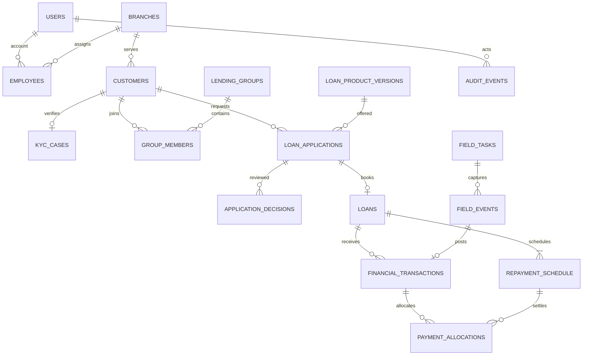
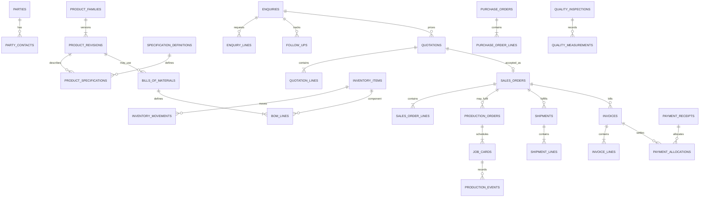

# Database relationships and integrity

## Verified current model

The website schema defines 24 tables; Flutter defines those concepts plus `cloud_connections`. Current tables are largely connected by integer columns in application code rather than SQL FOREIGN KEY clauses. `get_db()` opens SQLite without enabling `PRAGMA foreign_keys=ON` (website app.py:174-179). Thus apparent links such as application→customer, payment→loan and member→group are conventions, not enforced relational constraints.

## Proposed relationship map: retained MFI scope

Each arrow represents an enforced foreign key in a single device database. Cross-device identity uses `public_id`; local integer IDs are implementation keys only.

## Proposed relationship map: conditional manufacturing scope

Optional relationships are omitted where order policy is unknown (for example, make-to-stock production or direct invoices). Define them only after process discovery.

## Integrity rules

- Turn foreign-key enforcement on for every opened database connection; fail app initialization if the expected pragma is off.
- Restrict deletion: master records referenced by history are archived; posted events use reversal/correction records.
- Scope every query by active user permission and branch/site ownership. A valid FK does not provide authorization.
- Use unique `public_id` and operation/idempotency key constraints to make repeat import/sync safe.
- Monetary totals reconcile from immutable line/transaction rows; schedule allocations cannot exceed allowed transaction amount or balance without a documented exception.
- Inventory availability is derived from posted movements minus active reservations, within the same transaction that reserves or consumes stock.
- Every approval row records actor, role snapshot, timestamp, state before/after, reason and affected business revision.
- Use `ON DELETE RESTRICT` for financial, inventory, approval and audit dependencies. Cascades are acceptable only for disposable draft children with explicit, reviewed deletion semantics.
- Test orphan detection and reconciliation queries as release gates. No cascade may silently remove a posted record.
