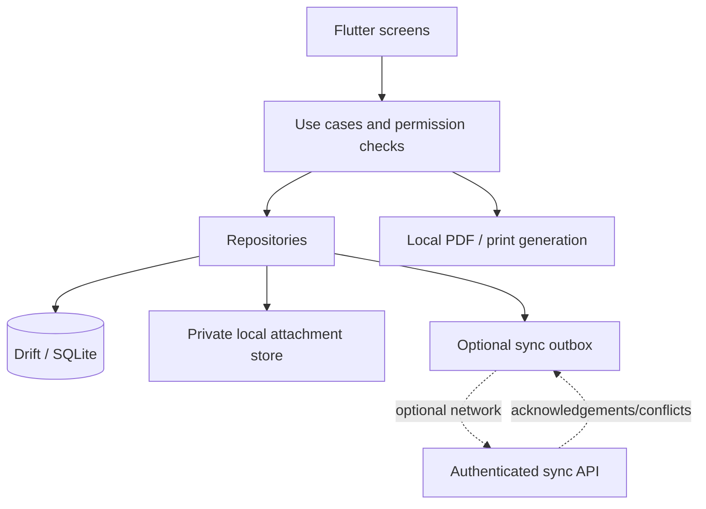

# Offline-first architecture

## Product boundary

Flutter already persists operations in SQLite. A SQLite file belongs to one installation/device; the Flask portal has a different server-side SQLite database. They do not share state automatically. The local website's service worker caches successful GET responses and provides an offline page, but that does not make POST-based edits, approvals or payments available offline.

Flutter's official persistence guide identifies on-device SQLite as relational data stored on the device and notes that Drift can provide local query streams. Drift is a proposed abstraction, not an already installed dependency. ([Flutter database guidance](https://docs.flutter.dev/data-and-backend/persistence/choose-a-database), [Drift package](https://pub.dev/packages/drift)).

## Proposed layers

The local database remains the source of truth for the current device. UI does not issue SQL directly. Domain operations transact all related rows and an audit event together.

## Fully offline core

- Login, unlock, role and permission evaluation from locally provisioned user/role grants.
- Search customers/products/orders and view cached records within user scope.
- Create and edit drafts, capture KYC or operational records, and validate locally.
- Approvals only for roles and records that are provisioned to the device; offline approval policy must define limits and expiry. Do not allow offline critical posting if required authorization cannot be trusted.
- MFI schedule, receipt and report generation; or conditional manufacturer quoting/stock/production workflows after approved scope.
- PDF/receipt generation and printing through locally available fonts/printers; image capture with durable private file storage.
- Local dashboard/reporting with an “as of” time and pending sync count.
- Backup, restore and data export with integrity check, access audit and sufficient free-space check.

## Data and sync boundaries

Each device has its own database and local IDs. Assign UUID `public_id` to every syncable record and a globally unique operation ID to each create/edit/post/reversal event. Track `local`, `pending`, `acknowledged`, `conflict`, `rejected` state; never treat connectivity as proof of synchronization.

The outbox stores immutable events with schema version, actor/device identity, captured time and payload digest. It excludes credentials, tokens and unnecessary raw identity data. Retry with exponential backoff and bounded batching. Server acknowledgement is per event and idempotent. Conflicting money, approvals, order revisions and stock quantities require explicit resolution; no last-write-wins merge.

For multi-device shared work, choose a single central authorization/ledger service or a controlled device handoff. Do not call independently edited local SQLite files a shared database. Web app and mobile app would need a versioned API contract and a documented source of truth.

Current Flutter behavior: the field-collection transaction commits the payment,
installment state, completed task, audit records and pending outbox event together.
The generic outbox helper requires a caller-stable operation ID, rechecks that
the actor is still active inside the transaction and treats a repeated identical
event as already queued; reusing the ID with a different actor or payload is
rejected. No sync backend is configured, so pending events remain local and the
UI reports that synchronization is unavailable. These controls do not establish
cross-device delivery or server-side idempotency.

Direct installment payment now also writes its payment, schedule update, audit
event and an `installment_payment` outbox event in one SQLite transaction. The
event contains local loan and schedule IDs, exact paise, channel, generated
reference and capture time. It remains a local pending record until a separately
approved versioned sync service is implemented; local integer IDs are not a
cross-device identity contract.

The unused legacy HTTP client and its session-cookie/password persistence helpers
have been removed. No unversioned server endpoint can be configured by the app;
any future sync client remains a separate, unapproved service-boundary task.

## Attachment and recovery design

Store binary attachments in an app-private directory with UUID filenames; database stores relative path, MIME type, size, checksum, owner, retention and encryption metadata. Save attachment to a temp file, verify checksum, atomically rename, then commit metadata. On failure, remove orphan temp files and do not commit a record that references a missing file. Avoid backing up transient cache and provide encrypted export for authorized transfer.

Backups contain schema version, app version, database, attachment manifest, checksums and encryption metadata. Restore runs into a staging location, validates integrity and free space, previews tenant/user identity, then performs an explicit atomic switch. Keep a recovery copy until the restored installation opens and reconciles.

## Offline limits to communicate

- A device cannot show another device's newly created records until synchronization or controlled transfer occurs.
- Revoked users/roles cannot be immediately revoked on a device with no network; define provision expiry and lockout policy.
- External payment, identity verification, WhatsApp, email and map services cannot complete offline. Queue only consented, non-critical messages; show their actual pending status.
- Branch/location and time evidence are device-reported and may be unavailable or manipulated. Keep source/accuracy metadata and review controls.
