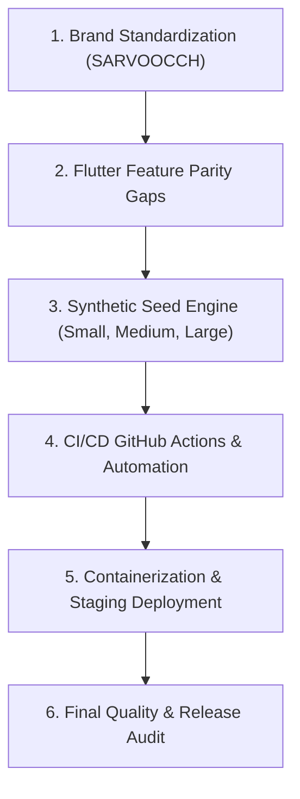

# SARVOOCCH — Critical Path Execution Plan

**Execution Horizon:** 3 November 2026 – 4 November 2026 (Deployment Day)  
**Execution Strategy:** Parallel, non-destructive, test-verified critical path  

---

## Critical Path Milestones

### Milestone 1: Brand Standardization (P0)
- Update text strings, headers, document titles, and app labels to strictly use **SARVOOCCH**.
- Preserve logo, palette, and existing layouts.

### Milestone 2: Flutter Website Parity Completion (P1)
- Add `BranchManagementScreen` (`/branches`): List, add branch dialog with GPS coords, radius, branch statistics.
- Add `HrmScreen` (`/hrm` & `/employees`): Staff onboarding checklist, leave requests/approvals, performance ratings, and payroll summary.
- Add `WhatsAppScreen` (`/whatsapp`): Customer list, 6-digit OTP generation, `wa.me` links, and code verification.
- Add `GroupApplyScreen` (`/pregrt-apply`): 2-5 member batch loan origination for verified groups.
- Add `DocumentViewerSheet`: In-app responsive preview for Loan Passbook, Login Slip, and KYC Dossier.

### Milestone 3: Realistic Synthetic Seed Engine (P1)
- Provide a robust Python/Dart script generating realistic fictional Indian names, Aadhaar last-4, PAN, and interconnected loan histories across Small (100 customers), Medium (5,000 customers), and Large (50,000 customers) datasets.

### Milestone 4: CI/CD Workflows (P1)
- `.github/workflows/verify.yml`: Automated pull request pipeline running `flutter test`, `flutter analyze`, and Flask unit tests.

### Milestone 5: Containerization & Deployment (P1)
- `Dockerfile` & `docker-compose.yml`: Reproducible staging deployment packaging Flask, Gunicorn, and static assets.

### Milestone 6: Final Independent Release Audit (P0)
- Verify that all criteria across security, finance, RBAC, parity, and testing pass without blocking defects.
